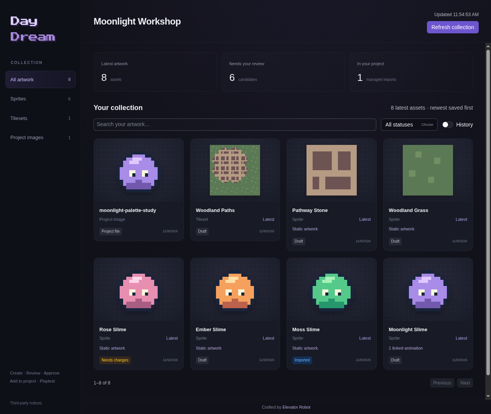
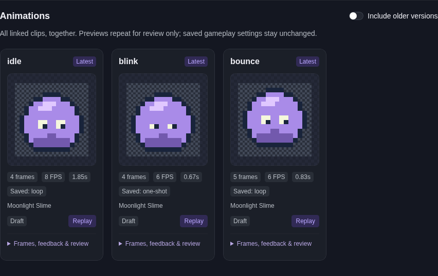

# Daydream

**Dream it. Make it playable.**

Make pixel-art assets for your Godot game with OpenCode. Describe what you want,
review the artwork, request changes, and choose when to add it to your project.

[Get started](#get-started) · [Make your first asset](#make-your-first-asset) ·
[User guide](docs/README.md) · [Troubleshooting](docs/TROUBLESHOOTING.md)



*A sample project using the artwork included in this repository.*

## What you can do

- **Keep your collection together.** Browse sprites, animations, tilesets and
  supported project images in a dashboard you can leave open beside your editor.
- **Review before adding.** See looping animation clips, compare versions, check
  palettes and leave feedback. Earlier versions stay available.
- **Understand your tilesets.** Browse individual tiles, terrain corners, layouts
  and collision data for Daydream-generated sets.
- **Try it in Godot.** Add separate asset files or safely update an unchanged
  managed asset, then preview the result. Daydream also helps with game code.

> **Early access:** pixel art is supported today. General image generation,
> automatic level design and full Godot editor control are not available.
> The dashboard shown here is on the preview branch in [PR #2](https://github.com/Elevator-Robot/daydream/pull/2).
> The setup below selects that branch.

## Get started

You need Linux or macOS, Python 3.9+, Git,
[OpenCode V2](https://opencode.ai/v2/docs/) connected to a model, and Godot 4 matching
your game. Generated tile layouts require Godot 4.3 or newer.

### 1. Install Daydream

Clone it into a folder you can keep in place:

```sh
git clone --branch feat/project-asset-dashboard https://github.com/Elevator-Robot/daydream.git ~/Code/daydream
cd ~/Code/daydream
```

Preview the installation, then apply it:

```sh
python3 scripts/install.py
python3 scripts/install.py --apply
```

Existing conflicting files are not overwritten. Restart OpenCode after installing.

### Enable pixel-art creation

Run once from the Daydream folder:

```sh
python3 -m venv .venv-sprites
.venv-sprites/bin/python -m pip install -r requirements-sprites.txt
```

Image support stays in Daydream's own Python environment. Skip this if you only
want help with code. The dashboard is already built; you do not need Node.js or npm.

### 2. Open your game

```sh
daydream /path/to/your/game
```

Or run `daydream` inside the game folder. For a first experiment, use a separate
project or scene and keep your game backed up. A fresh checkout may need Godot's
initial asset import before it can run; open it in its matching editor and let
that finish first.

### 3. Open your collection

Choose **`/assets` → Open project dashboard**. Leave it open beside Daydream and
click **Refresh collection** after changes. Click a sprite to see its artwork,
information and all linked animation clips.

## Make your first asset

In chat, or **`/assets` → Describe a new asset…**, try:

> Create a transparent 32×32 slime named Moonlight Slime. Use a soft purple palette.
> Show me a candidate before adding it to the game.

Then follow the five steps shown in the menus:

1. **Create.** Let Daydream prepare the candidate in chat.
2. **Review or revise.** Open `/assets` and inspect its preview. If it needs work,
   choose **Request changes**, save your note, then **Make revised version**.
3. **Approve.** Choose **Approve artwork** when satisfied. If asked for a reviewer
   label, your name or `user` is fine.
4. **Add or update.** Choose **Add or update in project**. For a first test, use
   **Add a separate copy**, keep its name, review the plan and confirm.
5. **Preview.** Choose **Preview this scene**. Once the asset is placed in your
   game, use `/preview game` to test it in context.

Approval does not add files yet. Adding a separate copy does not place it in your
level. Ask Daydream for that integration when you are ready.

Full walkthrough: [Your assets](docs/REVIEW.md).

## See the motion, not just a frame

Open a sprite and choose **View animations**. Its clips appear together in a
compact looping gallery, with frame counts, timing, saved playback settings and
review notes. Previews do not change how the animation plays in your game.



*Actual dashboard capture using sample artwork. A screenshot is still; watch the
previews move in the dashboard before approving animation.*

## Three commands to remember

| Command | What it does |
| --- | --- |
| `/assets` | Open the dashboard, create, review and add/update artwork |
| `/preview game` | Play the game's configured starting scene |
| `/preview stop` | Stop the game preview Daydream launched |

If a game preview fails, use `/preview status`. OpenCode's `/review` is for code,
not artwork.

## Keep going

| I want to… | Read this |
| --- | --- |
| Explore the dashboard and tilesets | [Project dashboard](docs/DASHBOARD.md) |
| Make a character, prop or animation | [Sprites and animations](docs/SPRITE_WORKFLOW.md) |
| Build walls, floors and terrain | [Environment tiles](docs/TILESETS.md) |
| Add collision shapes, ramps or platforms | [Collisions](docs/COLLISIONS.md) |
| Paint a generated layout in Godot | [Editable layouts](docs/EDITOR_LAYOUTS.md) |
| Keep old versions or update safely | [Versions and updates](docs/ASSET_LIFECYCLE.md) |

The [user guide](docs/README.md) links every task. For setup problems, start with
`daydream --doctor` or [Troubleshooting](docs/TROUBLESHOOTING.md).

<details>
<summary>Update an existing installation</summary>

From your Daydream folder:

```sh
git pull --ff-only
python3 scripts/install.py
python3 scripts/install.py --apply
```

Restart OpenCode afterwards. If Git reports local changes or installation reports
a conflict, resolve it without discarding your files.

</details>

<details>
<summary>Only want the coding agent?</summary>

Use `python3 scripts/install.py --agent-only --apply`. This lighter installation
does not include the launcher, dashboard or preview commands.

</details>

---

Crafted by [Elevator Robot](https://elevatorrobot.com).
Building Daydream itself? See the [contributor guide](docs/DEVELOPMENT.md).
