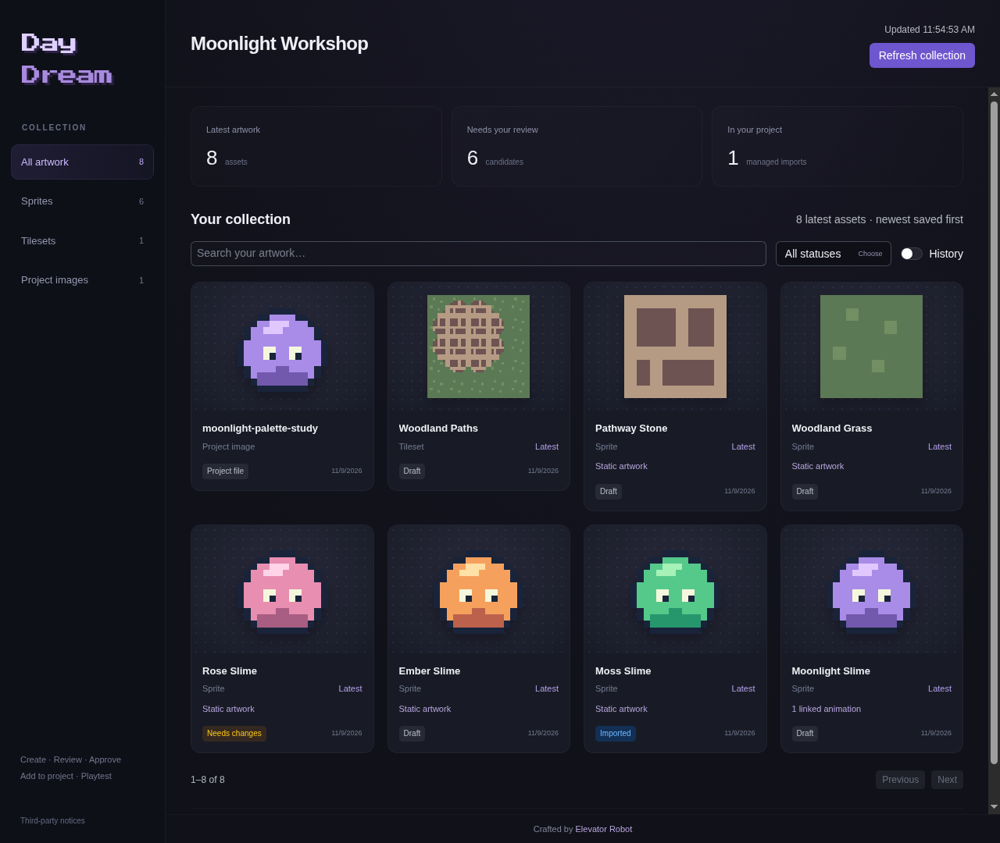
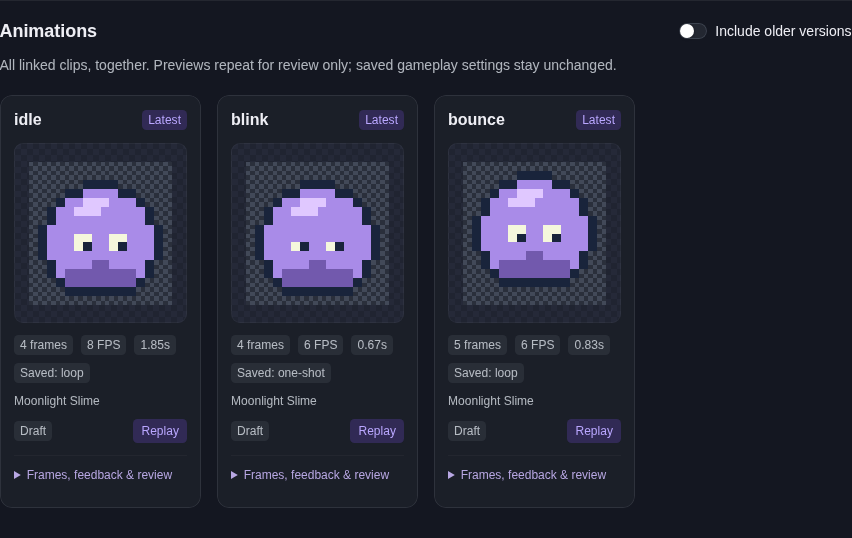
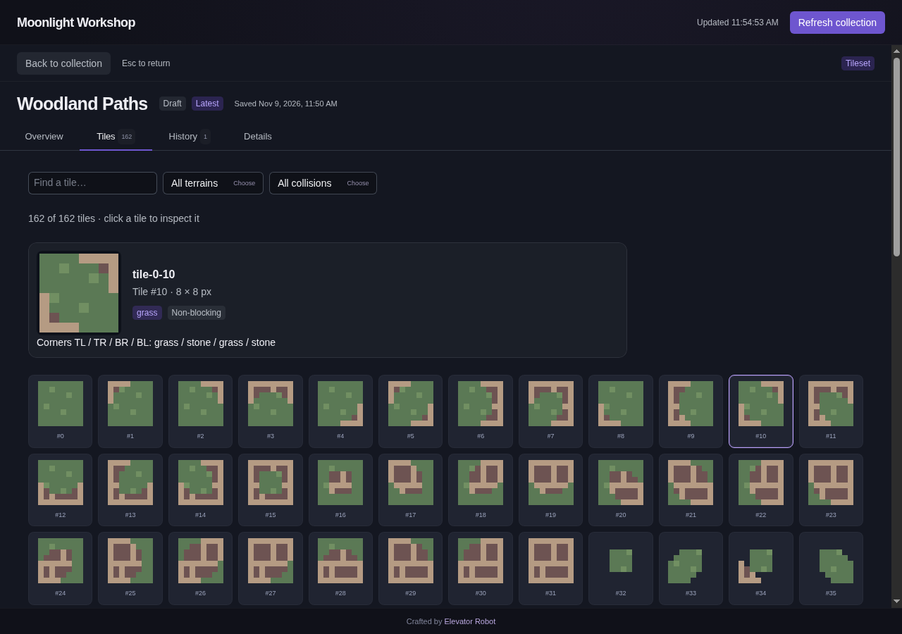

# Keep your project collection beside you

The project dashboard is a browser workspace for your artwork. Keep it open while
Daydream creates or revises assets, then refresh to see what changed.

## 1. Open your workspace

1. Open Daydream in your game project.
2. Run **`/assets` → Open project dashboard**.
3. Keep the browser beside your chat or Godot editor. Allow any requested project
   reads in Daydream so the collection and previews can load.

The dashboard is included in the standard installation. You do not need to install
a web framework, run a development server, or create an account.

*Sample project using the repository's example artwork.*

## 2. Find artwork

- Choose **All artwork**, **Sprites**, **Tilesets**, or **Project images**.
- Search by name or location and filter by review status.
- Enable **History** to include older revisions. **Latest** and **Older** labels
  distinguish versions; same-named sprites and animations have separate histories.
- Use **Previous / Next** at the bottom to browse larger collections.

Dropdowns consistently open below their controls. Long lists scroll; controls near
the bottom move into view before opening so the choices remain reachable.

Daydream candidates appear alongside supported existing images in the project.
**Project file** means existing artwork, not an approved Daydream candidate. Registered
output textures are linked to their managed asset rather than counted twice.
Existing sprites and sprite sheets appear under **Sprites** when referenced by a
Godot sprite/animation resource or stored in a `sprites` or `sprite` folder. They
are labelled **Project sprite** and retain their **Project file** status. Tileset
atlases stay under **Tilesets**, even inside a sprite folder. Other artwork remains
under **Project images**.
Managed previews show the staged candidate; manually edited project outputs may
differ. Their status and locations appear in the inspector. A different imported
revision is labelled explicitly.

## 3. Inspect an asset

Click a card to open full-page asset details. **Back to collection** stays visible
while you scroll; **Escape** also returns. Your filters, page and collection scroll
position are kept, and keyboard focus returns to the card you opened.

### Sprites and existing images

Inspect the artwork in a compact image preview beside its dimensions, palette,
saved time and status. Pictures fit their cards without internal scrollbars,
panning or zoom controls. Scroll the page normally; **Escape** returns to the
collection. On narrow screens the information panel moves below the artwork.

On desktop, asset information sits neatly to the right of the single image.
Turning **Compare** on adds the earlier reference and moves each version's
information beneath its own image. The change uses a subtle transition where
supported, with no animation when reduced motion is enabled. On narrow screens,
the information stays below the image in either mode. The selected asset and its
review action remain unchanged.
Both image panels keep the same dimensions when Compare is toggled. If two panels
cannot fit side by side, the reference stacks below rather than shrinking them.
Both sides use matching dimensions/count formatting and review-state badges so
differences in the metadata are easy to spot.

**Details** contains source locations, content identity, provenance and managed
output information where available.
For a project sprite, the information panel shows why it was classified and which
Godot resources reference it. You do not need to move or import the image first.
When Godot records supported frame regions or sprite grids, the card and overview
show an individual frame, not the whole sheet. Recorded SpriteFrames clips appear
in the same looping animation gallery as other sprites. **Frames** shows the source
frames and timing. Original artwork, timing and gameplay loop settings stay unchanged.
If no supported frame definitions are available, Daydream shows the original image
and explains the limitation rather than guessing a grid from the pixels.

### Animations

Animations live **inside their sprite's details**, not in a separate collection
category. Sprite cards show a linked-animation count. Open the sprite and choose
**View animations**, or scroll to its **Animations** section.

1. Browse the **Animations** gallery. Every clip from all the sprite's latest
   linked animation sets appears together. There is no bundle dropdown to find an attack,
   hurt, vanish or death clip.
2. Watch the looping previews and check each card's frame count, FPS, duration
   and saved loop behavior. **Replay** starts a particular preview again.
3. Expand **Frames, feedback & review** for the source frames, timelines, contact
   sheets and review notes belonging to that clip's source set.
4. Enable **Include older versions** if you want earlier candidates in the gallery.

Preview controls do not change the saved animation or gameplay.
The gallery uses lossless PNG/APNG animation previews, not a lossy GIF conversion.
Preview replay does not change a one-shot attack or death clip into a gameplay loop.
Animation links follow recorded source revisions, not matching names. If the
source sprite is missing or cannot be linked, the animated asset remains visible
under **Sprites** rather than being hidden. Existing arbitrary Godot SpriteFrames
resources are not automatically reconstructed by this dashboard.

*Open **Frames, feedback & review** on a card to inspect its source frames and notes.
Watch the live preview before approval; this screenshot does not show motion.*

### Tilesets

1. In **Overview**, choose the placed layout, complete atlas or available collision coverage.
2. Open **Tiles** to browse the entire validated tileset.
3. Filter by terrain, blocking/one-way geometry or tile ID.
4. Select a tile to see its enlarged artwork, terrain corners, collision overlay
   and exact polygon settings where present.

*The sample tileset has 162 terrain combinations. Select a tile to inspect its
corner rules; filter the collection without altering the source.*

Existing project atlases now appear under **Tilesets** too: the dashboard checks
direct atlas-image references in Godot text scenes/resources and images stored in
`tilesets`, `tileset` or `tilemaps` folders. Open one to inspect the complete atlas
and see where it was referenced. Folder-based candidates are labelled as such.

The tile-by-tile explorer uses Daydream metadata. For existing atlas images, tile
sizes, terrain and collision rules are not guessed from pixels or reconstructed
from arbitrary Godot resource graphs. If Tilesets is empty, check that you opened
the intended project, clear filters and refresh; discovery limits are shown.
The placed layout is the candidate's saved layout; manual painting in a Godot
scene does not synchronize back into that source view.

### Versions and feedback

**History** lists retained versions, newest saved first. Selecting one changes what
you inspect, not which artwork is approved or installed. **Open latest candidate**
returns you to the newest saved version. Review notes and recorded approval are
shown when present.

## 4. Refresh while you work

Click **Refresh collection**, or reload the browser page, after changes in chat or
the editor. Search/filter choices and the selected asset are retained. If a newer
candidate exists, your selected version is clearly marked **Older** instead of
silently switching the artwork you were inspecting.

Keep the Daydream terminal open. Closing or reloading its plugin disconnects the
dashboard; reopen it through `/assets` to reconnect. If refresh fails, the previous
snapshot stays visible with a warning that it may be stale.

## 5. Continue the guided asset flow

For a Daydream candidate, click **Copy review command**, then paste it into your
project's Daydream session. The command already identifies the selected asset.
Continue **review/revise → approve → add/update → preview** there.

The dashboard itself is read-only: browsing, refreshing, comparing and looping
previews never approve artwork, update game files or start a model request.

## Collection coverage

The dashboard includes Daydream revisions and supported project images: PNG, JPEG,
WebP, GIF, BMP and TGA. SVG files are listed with a clear unsupported-preview message.
Animated project image files show their first frame; full clip controls use managed
Daydream animation data. Hidden/build folders are excluded. A visible notice tells
you when a discovery or image-size limit prevents a complete view.

Next: [Your assets](REVIEW.md) · [Versions and updates](ASSET_LIFECYCLE.md) ·
[Preview and playtest](PREVIEW.md).
